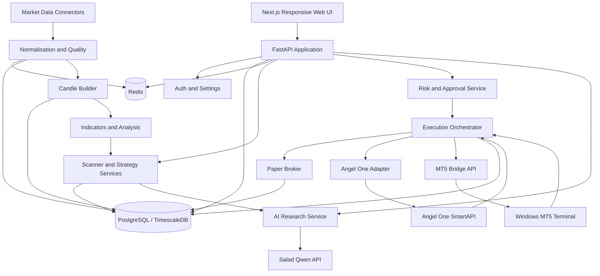
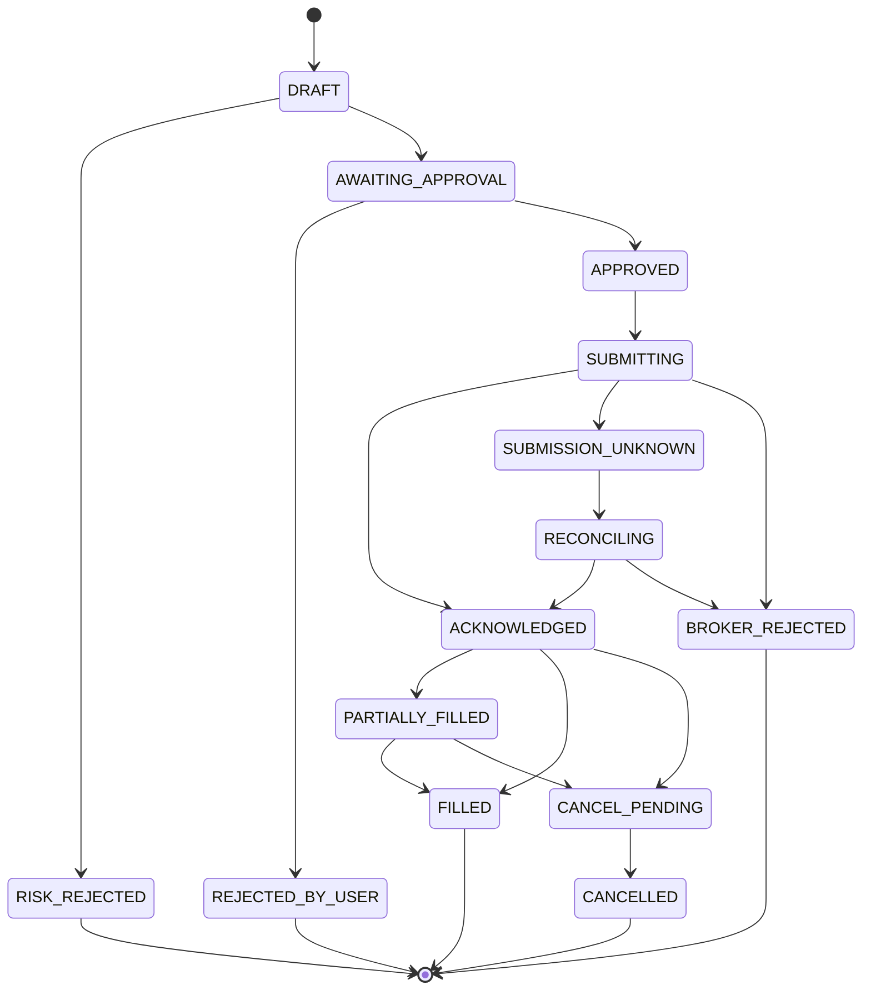

# System Architecture Specification
## AI-Assisted Intraday Trading Intelligence Platform

**Version:** 1.0  
**Architecture style:** Modular monolith + isolated workers + external broker bridges  
**Deployment:** Cloud Docker Compose initially

## 1. Architecture principles

1. Quantitative calculations are deterministic Python code.
2. LLM is an optional research service, never a source of truth for prices or risk.
3. Execution is isolated from analysis and requires manual approval.
4. Every price, signal and order is traceable to a provider, timestamp and version.
5. Provider adapters isolate vendor-specific APIs and identifiers.
6. Begin with a small number of deployable services; split only when measured load or reliability requires it.
7. Paper mode is the default and live mode is an explicit, separately configured capability.

## 2. Logical architecture



## 3. Deployable components

### 3.1 `frontend`
- Next.js + TypeScript.
- Responsive desktop/mobile browser UI.
- REST for queries and commands; WebSocket for live dashboard updates.
- Never call broker APIs directly from browser.
- Never store broker secrets or AI API keys in browser storage.

### 3.2 `api`
- FastAPI.
- Authentication, configuration, watchlists, candidate queries, research views, backtest management, order preview and approval.
- Pydantic request/response schemas.
- OpenAPI documentation.
- Server-side authorisation and validation for every command.

### 3.3 `market-worker`
- Runs provider connectors and historical import jobs.
- Handles reconnect/backoff, heartbeat and feed health.
- Converts source messages into canonical events.
- Writes latest values to Redis and persisted bars/snapshots to PostgreSQL/TimescaleDB.
- Separate task per provider so a failure is isolated.

### 3.4 `analysis-worker`
- Candle construction, indicators, strategy evaluation and scanner ranking.
- Deterministic and versioned.
- Does not call brokers to place orders.
- Emits candidate events and stores signal snapshots.

### 3.5 `research-worker`
- Consumes shortlisted candidate jobs.
- Builds bounded structured context from stored data.
- Calls configured LLM provider.
- Validates JSON against schema.
- Stores research and provider metadata.
- Retries transient failures with limits; no infinite retry loop.

### 3.6 `database`
- PostgreSQL with TimescaleDB extension if supported by selected image/host.
- Relational metadata, orders, positions, signals and audit.
- Hypertables for high-volume time-series tables where appropriate.
- Use migrations (Alembic).

### 3.7 `redis`
- Latest quotes, ephemeral state, task queue/cache and WebSocket fan-out.
- Redis is not the durable source of truth.
- Persist important events and business state in PostgreSQL.

### 3.8 `mt5-bridge` (separate Windows host)
- Small authenticated Python service next to the MT5 terminal.
- Connects to local MT5 Python package/terminal.
- Exposes only required, allow-listed operations.
- Outbound secure connection or tightly restricted VPN/tunnel to cloud; do not expose an unauthenticated MT5 API publicly.
- Reports terminal state, account identity, symbol mapping and heartbeat.
- Live order endpoint disabled until explicit activation and compliance checks.

### 3.9 `angelone-adapter`
- Server-side connector for SmartAPI authentication, market data and order lifecycle.
- Use official current SDK/API documentation.
- Store session credentials securely; respect token expiry and API limits.
- Handle broker order status updates and reconciliation.
- Validate static egress IP and broker API onboarding requirements before live orders.

## 4. Cloud topology

Recommended initial topology:

- One small cloud Linux VM with a fixed public IPv4 address.
- Docker Compose hosting frontend, API, workers, PostgreSQL and Redis.
- Firewall: expose only HTTPS (443); SSH restricted to the administrator's IP or VPN.
- Reverse proxy (Caddy or Nginx) terminates TLS.
- PostgreSQL and Redis remain on private Docker networks; no public ports.
- Encrypted off-host database backups.
- Salad endpoint accessed over outbound HTTPS.
- MT5 bridge remains on a Windows machine/VM with terminal installed; connect securely.
- Angel One API egress uses the approved static IP arrangement required by broker rules.

Do not select a cloud vendor or region solely on VM hourly price. Check fixed-IP cost, bandwidth, persistent disk, backups, latency to broker endpoints, and whether the static IP satisfies broker onboarding. Avoid placing broker credentials in a public frontend or in a public container image.

## 5. Data flow

### 5.1 Streaming
1. Connector receives provider event.
2. Validate source symbol/token mapping.
3. Convert to canonical instrument ID and UTC timestamp.
4. Validate event sequence/time, price bounds and duplicate key.
5. Publish latest quote to Redis.
6. Persist selected raw events/ticks according to storage policy.
7. Update candle builder.
8. Persist completed candle.
9. Trigger indicators and strategy evaluation.

### 5.2 Historical import
1. User/admin requests instrument/date range/provider.
2. Import job checks provider entitlement and limits.
3. Fetch bounded pages/ranges.
4. Map source identifiers to canonical instruments.
5. Validate gaps, duplicates and timezone.
6. Upsert idempotently.
7. Record import job status, source and coverage.
8. Mark data quality gaps rather than fabricating values.

### 5.3 Candidate and AI research
1. Strategy emits signal snapshot.
2. Scanner applies hard filters and score.
3. Candidate stored with strategy version and source data references.
4. Candidate enters AI queue only if eligible and within budget.
5. Research worker sends compact structured evidence to Qwen.
6. Response schema validation and safety checks.
7. UI shows AI opinion separately from deterministic signal and risk status.

## 6. Canonical data contracts

### 6.1 Normalised quote
```json
{
  "instrument_id": "internal-uuid",
  "provider": "angelone",
  "provider_instrument_key": "provider-specific-key",
  "event_time": "2026-11-06T09:20:00Z",
  "received_at": "2026-11-06T09:20:00.125Z",
  "last_price": 0.0,
  "bid": null,
  "ask": null,
  "volume": null,
  "quality": "VALID"
}
```

### 6.2 Candidate
```json
{
  "candidate_id": "uuid",
  "instrument_id": "uuid",
  "strategy_id": "uuid",
  "strategy_version": 1,
  "timeframe": "5m",
  "direction": "LONG",
  "score": 0,
  "score_components": {},
  "entry_zone": {},
  "invalidation": {},
  "target_scenarios": [],
  "data_as_of": "2026-11-06T09:20:00Z",
  "data_quality": "VALID",
  "status": "NEW"
}
```

### 6.3 AI research response
```json
{
  "summary": "string",
  "thesis": "string",
  "supporting_factors": [],
  "contradicting_factors": [],
  "missing_data": [],
  "risk_factors": [],
  "assessment": "WATCH",
  "confidence_explanation": "string"
}
```

AI response must not include executable broker commands. Any numerical levels it mentions must be traceable to the supplied snapshot and independently validated by application code.

## 7. API boundary

Initial API groups:

| Prefix | Responsibility |
|---|---|
| `/api/v1/auth` | Login, logout, session |
| `/api/v1/health` | Application and dependency health |
| `/api/v1/instruments` | Instrument master and mappings |
| `/api/v1/market` | Quotes, candles, feed status |
| `/api/v1/watchlists` | User watchlists |
| `/api/v1/analysis` | Indicators and market context |
| `/api/v1/strategies` | Strategy definitions and versions |
| `/api/v1/scanner` | Candidates and scanner configuration |
| `/api/v1/research` | AI research requests and reports |
| `/api/v1/backtests` | Backtest jobs and results |
| `/api/v1/risk` | Risk configuration and checks |
| `/api/v1/orders` | Preview, approve, status |
| `/api/v1/positions` | Paper/live position views |
| `/api/v1/brokers` | Connector health and account metadata |
| `/api/v1/audit` | Audit history |

Use WebSocket `/ws/v1/market` for subscribed quote/candidate updates. Authenticate WebSocket connections and restrict subscriptions to the user's allowed instruments.

## 8. Order state machine



- Every submission has a unique idempotency key.
- A timeout after submission is not proof that the broker did not receive the order.
- Reconcile order book/trade book before retrying.
- Record request, response, broker order ID, status transitions and timestamps.
- Never let a UI retry create a duplicate order.

## 9. Security model

- TLS for all external connections.
- Restrict inbound cloud firewall to HTTPS and administrator access.
- Use a secret manager where affordable; otherwise protected environment files with strict permissions.
- Encrypt backups and secrets.
- Hash passwords with Argon2id or another current password hashing scheme.
- Use secure, HttpOnly, SameSite cookies.
- CSRF protection for cookie-authenticated state-changing requests.
- Rate-limit authentication and order approval endpoints.
- Audit login, settings changes, approval, rejection, live-mode changes and kill-switch use.
- Redact tokens, passwords, TOTP seeds and personal account identifiers from logs.
- Keep paper and live broker credentials/configuration separate.
- No live trading until a security review and broker compliance checklist pass.

## 10. Observability and recovery

Metrics:
- Connector connected/disconnected state.
- Last event time and feed lag.
- Missing candle count.
- Import job progress and failure.
- Scanner run duration and candidate count.
- AI request count, latency, errors and estimated cost.
- Queue depth and worker heartbeat.
- Broker order reconciliation mismatches.
- Database storage and backup age.

Operational controls:
- `/health/live` and `/health/ready`.
- Structured JSON logs with correlation IDs.
- Daily encrypted database backup.
- Periodic restore test.
- Retention policy for tick data and AI payloads.
- Alert when market feed becomes stale or order state is unknown.

## 11. Suggested repository layout

```text
trading-platform/
  apps/
    web/                    # Next.js UI
    api/                    # FastAPI
  services/
    market_worker/
    analysis_worker/
    research_worker/
  connectors/
    base/
    angelone/
    historical_provider/
    mt5_bridge/
  packages/
    domain/                 # Shared domain models/enums
    schemas/                # Pydantic contracts
    strategies/
    risk/
  database/
    migrations/
    seed/
  tests/
    unit/
    integration/
    contract/
    backtest/
  deployment/
    compose/
    proxy/
    scripts/
  docs/
  .env.example
  docker-compose.yml
  README.md
```

## 12. Environment variables

Create `.env.example` with names and harmless placeholders only:

```dotenv
APP_ENV=development
APP_BASE_URL=https://localhost
APP_SECRET_KEY=replace_me
DATABASE_URL=postgresql+psycopg://app:replace_me@db:5432/trading
REDIS_URL=redis://redis:6379/0

AI_PROVIDER=salad
AI_BASE_URL=
AI_API_KEY=
AI_MODEL=

ANGELONE_API_KEY=
ANGELONE_CLIENT_ID=
ANGELONE_CLIENT_SECRET=
ANGELONE_TOTP_SECRET=

MT5_BRIDGE_URL=
MT5_BRIDGE_TOKEN=

HISTORICAL_PROVIDER=
HISTORICAL_API_KEY=

TRADING_MODE=paper
LIVE_TRADING_ENABLED=false
```

Do not put real values in `.env.example`. Use a local ignored `.env` for development or a cloud secret manager for deployment. Do not store a TOTP seed in plaintext in the database.

## 13. Deployment phases

### Development
- Docker Compose on a cloud VM.
- Synthetic/demo fixtures before broker credentials.
- Salad Qwen called via HTTPS.
- No live order capability.

### Integration testing
- Connect one market data feed.
- Validate timestamps and contract mappings.
- Test reconnection and data gaps.
- Run paper trading and broker sandbox/test facilities where available.

### Production candidate
- Fixed IP and broker onboarding confirmed.
- HTTPS and restricted administration.
- Backup/restore validated.
- Monitoring and alerting active.
- Live mode remains disabled until all gates are signed off.
