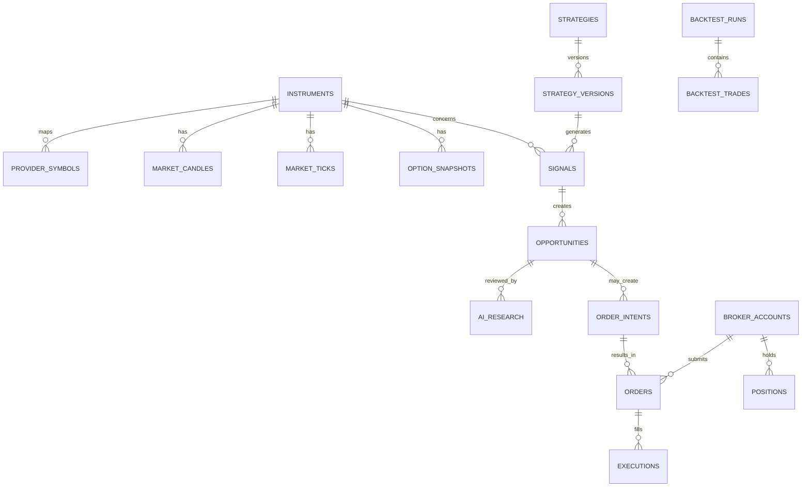

# Database Design Specification
## PostgreSQL + TimescaleDB

**Version:** 1.0  
**Design goal:** Traceable market data, reproducible signals and auditable execution.

## 1. Database conventions

- PostgreSQL is the source of truth for durable business records.
- TimescaleDB may be used for high-volume time-series tables if supported by the chosen hosting image.
- UUID primary keys for domain entities.
- Store event timestamps as `TIMESTAMPTZ` in UTC.
- Use `NUMERIC` for prices, quantities, rates and money; avoid binary floating-point for financial values.
- Store provider-specific raw payloads as JSONB only when useful and permitted.
- All important tables include `created_at`; mutable entities also include `updated_at`.
- Use Alembic migrations; do not modify production schema manually.
- Never store plaintext passwords, broker secrets, API tokens or TOTP seeds.

## 2. Entity relationship overview

## 3. Core reference tables

### 3.1 `instruments`
Canonical instrument registry.

| Column | Type | Notes |
|---|---|---|
| `id` | UUID PK | Internal ID |
| `canonical_symbol` | TEXT | Stable internal symbol |
| `display_name` | TEXT | UI name |
| `asset_class` | TEXT | INDEX, EQUITY, FUTURE, OPTION, COMMODITY, CRYPTO, CFD |
| `exchange` | TEXT | Exchange/venue |
| `segment` | TEXT | Provider/exchange segment |
| `underlying_id` | UUID FK nullable | Underlying instrument |
| `expiry_date` | DATE nullable | Derivative expiry |
| `strike_price` | NUMERIC nullable | Option strike |
| `option_type` | TEXT nullable | CE/PE |
| `lot_size` | NUMERIC nullable | Contract lot |
| `tick_size` | NUMERIC nullable | Minimum price increment |
| `contract_multiplier` | NUMERIC nullable | Contract multiplier |
| `currency` | TEXT | Quote currency |
| `is_active` | BOOLEAN | Active mapping |
| `metadata_source` | TEXT | Source of contract metadata |
| `metadata_verified_at` | TIMESTAMPTZ | Last verification |

Unique/index suggestions: unique canonical contract key; indexes on underlying, expiry, exchange, segment and active status.

### 3.2 `provider_symbols`
Maps a canonical instrument to each data/execution provider.

| Column | Type | Notes |
|---|---|---|
| `id` | UUID PK | |
| `instrument_id` | UUID FK | |
| `provider` | TEXT | ANGELONE, MT5, HISTORICAL_VENDOR |
| `provider_instrument_key` | TEXT | Token/symbol |
| `provider_exchange` | TEXT | |
| `data_enabled` | BOOLEAN | |
| `execution_enabled` | BOOLEAN | |
| `valid_from` | TIMESTAMPTZ | |
| `valid_to` | TIMESTAMPTZ nullable | |
| `last_verified_at` | TIMESTAMPTZ | |

Unique constraint: `(provider, provider_instrument_key, valid_from)` or a suitable active mapping constraint. A mapping may be data-enabled but not execution-enabled.

### 3.3 `provider_connections`
Non-secret connection metadata and health.

| Column | Type |
|---|---|
| `id` | UUID PK |
| `provider` | TEXT |
| `connection_name` | TEXT |
| `environment` | TEXT |
| `status` | TEXT |
| `last_connected_at` | TIMESTAMPTZ |
| `last_event_at` | TIMESTAMPTZ |
| `last_error_code` | TEXT nullable |
| `last_error_summary` | TEXT nullable |
| `updated_at` | TIMESTAMPTZ |

Secrets must be stored outside this table in a secret manager or protected environment.

## 4. Market data tables

### 4.1 `market_ticks`
Optional high-volume tick archive. Partition/hypertable by `event_time` if retention and volume justify it.

| Column | Type |
|---|---|
| `event_time` | TIMESTAMPTZ |
| `instrument_id` | UUID |
| `provider` | TEXT |
| `received_at` | TIMESTAMPTZ |
| `last_price` | NUMERIC |
| `bid_price` | NUMERIC nullable |
| `ask_price` | NUMERIC nullable |
| `last_quantity` | NUMERIC nullable |
| `volume` | NUMERIC nullable |
| `quality_status` | TEXT |
| `provider_sequence` | TEXT nullable |

Use composite primary/unique key appropriate to provider event identity, e.g. `(instrument_id, provider, event_time, provider_sequence)` where sequence exists. Do not assume timestamps alone uniquely identify ticks.

### 4.2 `market_candles`
Canonical OHLCV bars.

| Column | Type |
|---|---|
| `id` | UUID PK or composite key |
| `instrument_id` | UUID FK |
| `timeframe` | TEXT |
| `bar_time` | TIMESTAMPTZ |
| `open` | NUMERIC |
| `high` | NUMERIC |
| `low` | NUMERIC |
| `close` | NUMERIC |
| `volume` | NUMERIC nullable |
| `provider` | TEXT |
| `is_complete` | BOOLEAN |
| `quality_status` | TEXT |
| `source_revision` | TEXT nullable |

Unique key: `(instrument_id, timeframe, bar_time, provider)`. Retain source-specific bars; do not silently overwrite one provider with another. A canonical preferred series can be selected through a view/service.

### 4.3 `data_import_jobs`
Tracks historical ingestion.

Columns: `id`, `provider`, `instrument_id`, `timeframe`, `from_time`, `to_time`, `status`, `records_received`, `records_inserted`, `gap_count`, `error_summary`, `started_at`, `finished_at`, `created_at`.

### 4.4 `data_quality_events`
Tracks stale feed, gap, duplicate, outlier, mapping failure and timestamp issues.

Columns: `id`, `provider`, `instrument_id`, `event_type`, `severity`, `event_time`, `details JSONB`, `resolved_at`, `created_at`.

### 4.5 `option_snapshots`
Stores point-in-time option chain observations.

Columns: `id`, `underlying_id`, `contract_instrument_id`, `snapshot_time`, `underlying_price`, `open_interest`, `oi_change`, `volume`, `iv`, `delta`, `gamma`, `theta`, `vega`, `bid`, `ask`, `last_price`, `provider`, `quality_status`.

Do not calculate missing Greeks and store them as if they were provider values. Record calculation source/version separately if deriving them.

## 5. Analysis and strategy tables

### 5.1 `strategies`
Columns: `id`, `name`, `description`, `asset_class`, `enabled`, `created_at`, `updated_at`.

### 5.2 `strategy_versions`
Columns: `id`, `strategy_id`, `version_number`, `parameters JSONB`, `code_version`, `effective_from`, `created_at`, `created_by`.

Immutable once used in a signal/backtest. Create a new version for changes.

### 5.3 `indicator_snapshots`
Columns: `id`, `instrument_id`, `timeframe`, `bar_time`, `strategy_context JSONB`, `indicator_values JSONB`, `source_candle_ids JSONB`, `calculation_version`, `created_at`.

### 5.4 `signals`
Columns: `id`, `instrument_id`, `strategy_version_id`, `timeframe`, `direction`, `signal_time`, `entry_zone JSONB`, `invalidation JSONB`, `target_scenarios JSONB`, `input_snapshot JSONB`, `data_quality`, `status`, `created_at`.

A signal records what the deterministic engine observed at the time. Do not update old signals to reflect later data.

### 5.5 `opportunities`
Columns: `id`, `signal_id`, `rank`, `score`, `score_components JSONB`, `hard_filter_results JSONB`, `lifecycle_status`, `first_seen_at`, `last_seen_at`, `expires_at`, `created_at`.

Score must not be represented as win probability unless separately calibrated and validated.

### 5.6 `ai_research`
Columns: `id`, `opportunity_id`, `provider`, `model_name`, `model_version`, `prompt_version`, `input_snapshot_ref`, `response_json JSONB`, `validation_status`, `latency_ms`, `input_tokens`, `output_tokens`, `estimated_cost`, `error_summary`, `created_at`.

AI report is immutable. Re-analysis creates another row.

## 6. Backtesting tables

### 6.1 `backtest_runs`
Columns: `id`, `strategy_version_id`, `instrument_universe JSONB`, `timeframe`, `from_time`, `to_time`, `data_source`, `cost_model JSONB`, `slippage_model JSONB`, `parameters JSONB`, `status`, `metrics JSONB`, `code_version`, `created_at`, `finished_at`.

### 6.2 `backtest_trades`
Columns: `id`, `backtest_run_id`, `instrument_id`, `entry_time`, `exit_time`, `side`, `entry_price`, `exit_price`, `quantity`, `gross_pnl`, `fees`, `slippage`, `net_pnl`, `exit_reason`, `metadata JSONB`.

### 6.3 `paper_accounts`, `paper_orders`, `paper_fills`, `paper_positions`
Keep simulated account state separate from live broker records. Include deterministic fill model and explicit assumptions. Paper results must never be presented as broker-confirmed live fills.

## 7. Execution and audit tables

### 7.1 `broker_accounts`
Columns: `id`, `broker`, `display_name`, `environment`, `account_reference_masked`, `status`, `last_reconciled_at`, `created_at`, `updated_at`.

Do not store passwords, API keys, session tokens or TOTP secrets here.

### 7.2 `order_intents`
The user-approved proposal before broker submission.

Columns: `id`, `opportunity_id`, `broker_account_id`, `instrument_id`, `side`, `order_type`, `product_type`, `quantity`, `limit_price`, `trigger_price`, `risk_check_result JSONB`, `approval_status`, `approved_at`, `approved_by`, `expires_at`, `idempotency_key`, `created_at`.

### 7.3 `orders`
Columns: `id`, `order_intent_id`, `broker_account_id`, `broker_order_id`, `client_order_reference`, `status`, `requested_payload JSONB`, `broker_response JSONB`, `submitted_at`, `updated_at`, `last_reconciled_at`.

Unique constraints on idempotency key and broker/account/order identity where available.

### 7.4 `executions`
Columns: `id`, `order_id`, `broker_execution_id`, `execution_time`, `quantity`, `price`, `fees`, `raw_reference JSONB`, `created_at`.

### 7.5 `positions`
Columns: `id`, `broker_account_id`, `instrument_id`, `environment`, `side`, `net_quantity`, `average_price`, `realised_pnl`, `unrealised_pnl`, `last_synced_at`, `status`.

### 7.6 `risk_events`
Columns: `id`, `order_intent_id`, `rule_code`, `severity`, `decision`, `details JSONB`, `created_at`.

### 7.7 `audit_logs`
Columns: `id`, `actor_type`, `actor_id`, `action`, `entity_type`, `entity_id`, `correlation_id`, `ip_address`, `details JSONB`, `created_at`.

Audit logs should be append-only at application level. Avoid writing secrets or unnecessary personal data into audit details.

## 8. Application tables

- `users`: single local user initially; password hash, status, timestamps.
- `user_preferences`: timezone, display settings, default watchlist and UI preferences.
- `watchlists`: name, owner, created_at.
- `watchlist_items`: watchlist_id, instrument_id, sort_order.
- `scanner_configs`: universe, timeframe, strategy filters, thresholds, enabled.
- `risk_profiles`: max order value, max quantity, max open positions, daily loss limit, per-trade risk and enabled flag.
- `system_settings`: non-secret settings only.
- `notifications`: event type, payload, read status, created_at.

## 9. Indexing and retention

Initial indexes:
- `market_candles(instrument_id, timeframe, bar_time DESC)`.
- `market_ticks(instrument_id, event_time DESC)`.
- `option_snapshots(underlying_id, snapshot_time DESC)`.
- `signals(signal_time DESC, instrument_id)`.
- `opportunities(lifecycle_status, score DESC, last_seen_at DESC)`.
- `orders(broker_account_id, status, submitted_at DESC)`.
- `executions(order_id, execution_time)`.
- `audit_logs(created_at DESC, entity_type, entity_id)`.

Retention:
- Keep candles and business/audit records according to user needs and legal/provider terms.
- Tick data can consume substantial storage; begin with selective retention or short retention.
- Do not delete records needed for open positions, order reconciliation or audit.
- Back up before retention cleanup.
- Historical data retention must respect provider licence and exchange terms.

## 10. Migration order

1. Users, settings, audit.
2. Instruments, provider symbols, provider connections.
3. Data imports, quality events, candles.
4. Strategies, versions, indicator snapshots, signals, opportunities.
5. AI research.
6. Backtests and paper trading.
7. Broker accounts, order intents, orders, executions, positions, risk events.

Implement migrations in small, reversible steps. Add foreign keys and unique constraints early. Use fixtures for tests; never seed fake live broker credentials.
